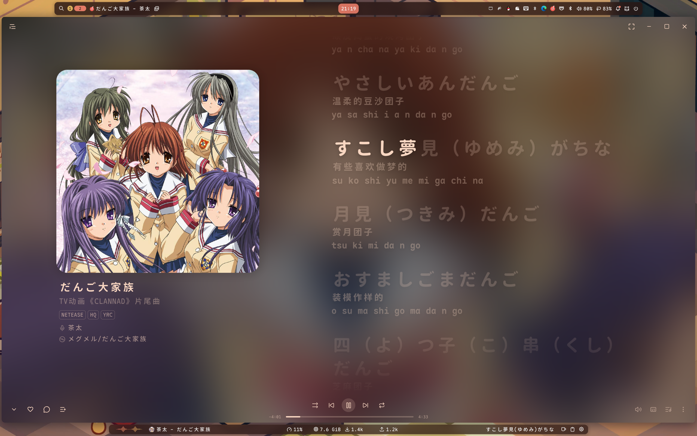

<h1 align="center">
    
    <br>
    MyFlake
</h1>

<p align="center">
    <strong>NixOS · niri · Noctalia · Home Manager</strong>
    <br>
    一份配置，从系统到桌面。
</p>

<p align="center">
    面向 <code>x86_64-linux</code> 主机 <code>nixos</code> 的个人 Flake，统一管理系统、桌面、开发环境、AI CLI、透明代理与自定义包。
</p>

<div align="center">
    <a href="https://github.com/ainnhuomiao/MyFlake/actions/workflows/nix.yml">
        
    </a>
    <a href="https://nixos.org">
        
    </a>
    <a href="https://github.com/xddxdd/nix-cachyos-kernel">
        
    </a>
    <a href="https://flake.parts">
        
    </a>
    <a href="https://github.com/ainnhuomiao/MyFlake">
        
    </a>
</div>

<p align="center">
    <a href="#桌面预览">桌面预览</a> ·
    <a href="#配置概览">配置概览</a> ·
    <a href="#目录结构">目录结构</a> ·
    <a href="#日常维护">日常维护</a> ·
    <a href="#常用-niri-快捷键">快捷键</a> ·
    <a href="#全新安装">全新安装</a>
</p>

## 桌面预览

<p align="center">
    <a href="assets/screenshots/music.png">
        
    </a>
</p>

<p align="center"><sub>实际桌面截图 · 点击图片查看原图</sub></p>

> [!NOTE]
> 这是与个人硬件、用户名和本地状态绑定的配置，不是开箱即用的通用模板。复用前请检查 `me.nix`、`hosts/nixos/`、磁盘布局以及涉及个人凭据的配置。

## 配置概览

| 项目       | 当前配置                                                               |
| ---------- | ---------------------------------------------------------------------- |
| Flake      | `flake-parts` + `nixos-unstable-small`                                 |
| 平台       | `x86_64-linux`，主机 `nixos`                                           |
| 内核       | CachyOS latest `x86_64-v3`（`linuxPackages-cachyos-latest-x86_64-v3`） |
| 桌面       | niri + Noctalia `v5.2.1`，getty 自动登录，无显示管理器                 |
| 用户环境   | Home Manager，作为 NixOS 模块集成                                      |
| Shell      | Fish + Starship + Kitty                                                |
| 外观       | Catppuccin Mocha；Noctalia 深色模式与壁纸取色                          |
| 显卡       | Intel 核显负责桌面，雷电 RTX 3050 通过 PRIME offload 运行游戏          |
| 音频与网络 | PipeWire + NetworkManager                                              |
| 代理       | sing-box TUN + metacubexd，按需手动启动                                |
| 二进制缓存 | ncro 统一调度 Attic、Cachix、国内镜像与官方缓存                        |
| 引导与磁盘 | GRUB EFI + Btrfs 子卷 + Swap                                           |
| 容器       | Docker + Distrobox + Flatpak                                           |

配置入口：

```text
flake.nix
└── hosts/default.nix
    └── nixosConfigurations.nixos
        ├── hosts/nixos/
        ├── system/
        └── home/profiles/nixos/
```

### 桌面与外观

- niri 使用滚动平铺，普通窗口默认满宽打开，`Super + f` 在满宽与半屏之间切换。
- Noctalia 提供顶栏、底栏、启动器、通知、剪贴板、锁屏和电源菜单；透明栏模糊与圆角样式由仓库内补丁和配置统一维护。
- 终端、编辑器与 GTK 使用 Catppuccin Mocha；Noctalia 使用深色壁纸取色，让状态栏和面板跟随当前壁纸。
- 静态壁纸由 Noctalia 管理，视频壁纸由官方 mpvpaper 插件管理。资源位于 `assets/wallpapers/` 和 `assets/videos/`，并链接到 `~/Pictures/wallpapers` 与 `~/Videos/wallpapers`。
- 常用应用包括 Firefox、Zen Browser、Chrome、SPlayer-Next、MPV、Obsidian、Nemo、Yazi，以及 Fcitx5 + Rime 中文输入。

窗口规则、输出和完整键位集中在 `home/wm/niri/config.nix`，Noctalia 设置位于 `home/programs/noctalia/`。

### 开发与 AI

- 编辑器：Neovim（AstroNvim v6）、VS Code、Helix。
- 工具链：C/C++、Rust、Go、TypeScript/Node.js、Haskell，以及 Direnv、nixd、nixfmt、treefmt。
- AI 工具：Codex、Claude Code、Kimi Code CLI/Desktop、OpenCode、Antigravity、Oh My Pi、Pi、Cursor Agent 与 Herdr。
- MCP：Context7、mcp-nixos、flake-stats-mcp 统一声明在 `home/ai/mcp.nix`，激活时合并到各客户端，保留本地其他配置。

```bash
nix develop          # 默认开发环境
nix develop .#secret # age、sops、ssh-to-age
```

### 雷电显卡坞

桌面始终由 Intel 核显渲染；需要独显时使用 `nvidia-egpu`，GPU 不可用时会回退核显。

```bash
# Steam 启动选项
nvidia-egpu %command%

# 游戏退出后，按提示安全卸载驱动再关闭显卡坞电源
nvidia-egpu-off
```

相关配置位于 `system/hardware/egpu.nix`。显卡坞通电期间不要合盖挂起。

### 代理与缓存

sing-box 负责 TUN、DNS 和分流，不随开机启动；订阅只保存在 `/var/lib/sing-box-config/subscriptions.yaml`，不会进入 Nix store。

```bash
sing-box-sub                       # 管理订阅
sing-box-toggle [on|off|status]     # 控制透明代理
```

Web 面板为 `http://127.0.0.1:9090/ui/`，认证密钥保存在 `/var/lib/sing-box-config/clash-api-secret`。

Nix 下载统一经过本机 ncro（`127.0.0.1:5496`），在多个缓存上游之间自动选路。CI 将固定候选包与系统、Home Manager 直接安装的包合并，按 derivation 去重后自动跳过已有缓存，只编译未命中项并增量推送到自建 Attic；完整系统闭包仍需在本机用 `just build` 验证。

### 自定义包与 Flake 输出

仓库自有包放在 `pkgs/`，nixpkgs 修补放在 `overlays/`。对外 `packages` 只保留固定 CI 缓存候选和 `disko`，实际清单以命令为准：

```bash
nix flake show

# 构建只通过 overlay 提供的 omp-provider
nix build .#nixosConfigurations.nixos.pkgs.omp-provider
```

## 目录结构

```text
.
├── assets/                  # 截图、静态壁纸与视频壁纸
├── flake/modules/           # packages、checks、devShells、formatter 与 overlays
├── home/                    # Home Manager 模块
│   ├── ai/                  # AI CLI 与 MCP
│   ├── dev/                 # 开发工具链
│   ├── editors/             # Neovim 与 VS Code
│   ├── profiles/            # 用户@主机配置组合
│   ├── programs/            # 应用配置与纯安装应用
│   ├── shell/               # Fish、Starship 与 Shell 工具
│   ├── terminals/           # 终端配置
│   ├── wall/                # 静态与视频壁纸
│   └── wm/niri/             # niri 配置
├── hosts/nixos/             # 当前物理机配置
├── lib/
│   ├── disko-layout/        # 普通单盘与 LUKS 单盘布局
│   ├── proxy/               # sing-box 配置生成与管理脚本
│   ├── scripts/             # 安装、重建等脚本
│   └── appearance.nix       # 公共配色与外观数据
├── overlays/                # nixpkgs overlays
├── pkgs/                    # 仓库自有包
├── system/                  # NixOS 系统模块
├── flake.nix                # inputs 与 Flake 入口
├── justfile                 # 常用命令
└── me.nix                   # 用户名、Git 信息与初始密码哈希
```

模块约定：主机无关的系统配置放在 `system/`，用户配置放在 `home/`；各目录的 `default.nix` 负责聚合同目录模块。`me.nix` 与 `lib/appearance.nix` 通过模块参数复用。

## 日常维护

| 命令                         | 作用                                          |
| ---------------------------- | --------------------------------------------- |
| `just`                       | 列出全部命令                                  |
| `just update`                | 更新所有 Flake inputs                         |
| `just update-input <name>`   | 更新单个 input                                |
| `just format`                | 格式化仓库                                    |
| `just check`                 | 执行 `nix flake check --fallback`             |
| `just build [host]`          | 构建完整系统，不激活；默认 `nixos`            |
| `just verify`                | 依次执行格式化与检查                          |
| `just rebuild-switch [host]` | 检查、格式化、构建并切换到新系统              |
| `just generations`           | 查看 NixOS generations                        |
| `just clean`                 | 清理旧 generations 与 gcroots，保留 3 代/7 天 |

常规验证与切换：

```bash
just format
just check
just build
just rebuild-switch
```

> [!WARNING]
> `just clean` 会不可逆地删除旧 generations 与 gcroots，之后无法回滚到这些版本。`just rebuild-switch` 会立即切换当前机器；内核更新后还需重启。

推送 `main` 会触发 CI。依赖更新后应在本地完成上述验证，再按需提交并推送 `flake.lock`。

## 常用 niri 快捷键

`Mod` 即 `Super`。完整配置见 `home/wm/niri/config.nix`，也可按 `Super + Shift + /` 查看桌面快捷键说明。

| 按键                              | 功能                         |
| --------------------------------- | ---------------------------- |
| `Super + Return`                  | 打开 Kitty                   |
| `Super + Shift + Return`          | 打开浮动 Kitty               |
| `Super + z`                       | Noctalia 应用启动器          |
| `Super + v`                       | 剪贴板历史                   |
| `Super + o`                       | 显示/隐藏状态栏              |
| `Super + Tab`                     | 工作区概览                   |
| `Alt + Tab` / `Alt + Shift + Tab` | 最近窗口正向/反向切换        |
| `Super + 方向键 / HJKL`           | 切换列或列内窗口焦点         |
| `Super + Shift + 方向键 / HJKL`   | 移动列或列内窗口             |
| `Super + 1..5`                    | 切换命名工作区               |
| `Super + Shift + 1..5`            | 窗口发送到工作区，不跟随     |
| `Super + Ctrl + 1..5`             | 窗口发送到工作区并跟随       |
| `Super + q` / `Alt + F4`          | 关闭窗口                     |
| `Super + f` / `Super + Shift + f` | 满宽/半屏切换 / 真全屏       |
| `Super + Space`                   | 切换浮动与平铺               |
| `Super + r`                       | 切换列宽 ⅓、½、⅔             |
| `Super + Ctrl + 方向键`           | 切换显示器焦点               |
| `Super + Shift + x`               | 锁屏                         |
| `Super + Shift + p`               | 电源与会话菜单               |
| `Print`                           | Flameshot 截图与标注         |
| `Super + [` / `Super + a`         | niri 交互截图，保存并复制    |
| `Super + ]`                       | Grimshot 区域截图，仅复制    |
| 媒体/亮度键                       | 播放、音量、麦克风与亮度控制 |

## 全新安装

### 1. 准备环境

从 NixOS Minimal ISO 启动并联网：

```bash
git clone https://github.com/ainnhuomiao/MyFlake.git
cd MyFlake
nix develop --extra-experimental-features 'nix-command flakes'
```

### 2. 修改个人与硬件配置

至少检查 `me.nix`、`hosts/nixos/` 和 `lib/disko-layout/`。不要复用当前机器的磁盘 UUID、设备路径或密码哈希。

### 3. 分区、安装与重启

```bash
just disko
just install
reboot
```

`just disko` 提供普通单盘与 LUKS 单盘两种 Btrfs 布局，并生成目标主机的硬件配置；`just install` 设置用户密码并执行 `nixos-install`。

> [!WARNING]
> `just disko` 会清空目标磁盘。执行前必须核对设备路径，并确认输入 `YES` 前选择的是正确磁盘。

## 注意事项

- `me.nix` 含个人信息和初始密码哈希；不要把令牌、订阅 URL 或其他密钥写入 Nix 文件。
- 当前用户拥有免密码 sudo，sshd 仍允许密码登录，仅适合受控的个人设备。
- 配置允许 unfree 包，并固定了部分上游版本；升级前先阅读相关注释并运行完整验证。
- 如果新系统无法启动，可从 GRUB 选择旧 NixOS generation 回退。

## 参考

- [NixOS](https://nixos.org/)
- [Home Manager](https://github.com/nix-community/home-manager)
- [flake-parts](https://flake.parts/)
- [niri](https://github.com/YaLTeR/niri)
- [Noctalia](https://github.com/noctalia-dev/noctalia)
- [Disko](https://github.com/nix-community/disko)
- [Ruixi-rebirth/flakes](https://github.com/Ruixi-rebirth/flakes)
