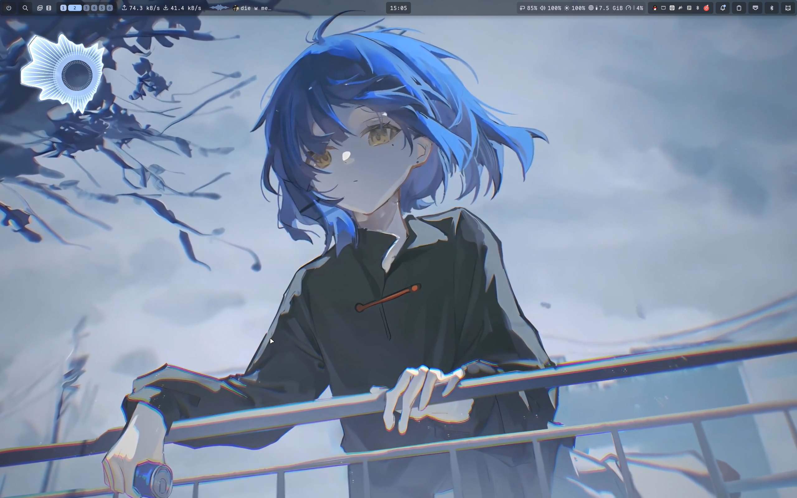
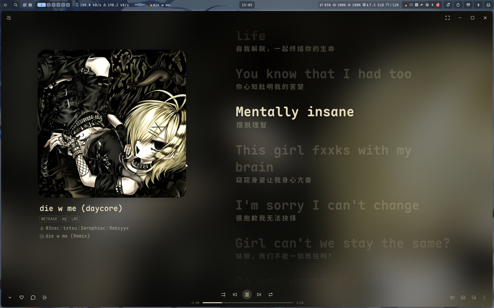

<h1 align="center">
    
    <br>
    MyFlake
</h1>

<p align="center">
    <strong>NixOS · niri · Noctalia · Home Manager</strong>
    <br>
    一份配置，从系统到桌面。
</p>

<p align="center">
    面向 <code>x86_64-linux</code> 主机 <code>nixos</code> 的个人 Flake，统一管理系统、桌面、开发环境、AI CLI、透明代理与自定义包。
</p>

<div align="center">
    <a href="https://github.com/ainnhuomiao/MyFlake/actions/workflows/nix.yml">
        
    </a>
    <a href="https://nixos.org">
        
    </a>
    <a href="https://github.com/zen-kernel/zen-kernel">
        
    </a>
    <a href="https://flake.parts">
        
    </a>
    <a href="https://github.com/ainnhuomiao/MyFlake">
        
    </a>
</div>

<p align="center">
    <a href="#桌面预览">桌面预览</a> ·
    <a href="#配置概览">配置概览</a> ·
    <a href="#目录结构">目录结构</a> ·
    <a href="#日常维护">日常维护</a> ·
    <a href="#常用-niri-快捷键">快捷键</a> ·
    <a href="#全新安装">全新安装</a>
</p>

## 桌面预览

<table>
    <tr>
        <td width="50%" align="center">
            <a href="assets/screenshots/desktop.png">
                
            </a>
        </td>
        <td width="50%" align="center">
            <a href="assets/screenshots/music.png">
                
            </a>
        </td>
    </tr>
</table>

<p align="center"><sub>实际桌面截图 · 点击图片查看原图</sub></p>

> [!NOTE]
> 这是与个人硬件、用户名和本地状态绑定的配置，不是开箱即用的通用模板。复用前必须检查 `me.nix`、`hosts/nixos/`、磁盘布局以及涉及个人凭据的配置。

## 配置概览

| 项目         | 当前配置                                                                      |
| ------------ | ----------------------------------------------------------------------------- |
| Flake        | `flake-parts`                                                                 |
| Nixpkgs      | `nixos-unstable-small`                                                        |
| 平台         | `x86_64-linux`                                                                |
| 主机         | `nixos`                                                                       |
| 内核         | Linux Zen（nixpkgs `linuxPackages_zen`）                                      |
| 显卡         | 雷电显卡坞外接 RTX 3050（PRIME offload）                                      |
| 桌面         | niri（getty 自动登录，经 niri-session 进入）                                  |
| 用户环境     | Home Manager，作为 NixOS 模块集成                                             |
| Shell        | Fish + Starship                                                               |
| 音频         | PipeWire（ALSA、PulseAudio、JACK）                                            |
| 网络         | NetworkManager + dae eBPF + Mihomo SOCKS                                      |
| 二进制缓存   | GitHub Actions → Attic（VPS）+ Cachix + selector4nix 代理 + USTC 镜像（备用） |
| 引导         | GRUB EFI                                                                      |
| 文件系统     | Btrfs 子卷 + 独立 EFI 分区 + Swap                                             |
| 容器         | Docker + Distrobox + Flatpak                                                  |
| 系统状态版本 | NixOS `26.05`，Home Manager `25.11`                                           |

当前配置入口为：

```text
flake.nix
└── hosts/default.nix
    └── nixosConfigurations.nixos
        ├── hosts/nixos/
        ├── system/
        └── home/profiles/huomiao@nixos
```

## 主要功能

### 内核

当前主机使用 nixpkgs 提供的 Linux Zen 内核，`hosts/nixos/default.nix` 中设置 `boot.kernelPackages = pkgs.linuxPackages_zen`。此前使用的 CachyOS 内核（`xddxdd/nix-cachyos-kernel`）因上游二进制缓存服务器被入侵而下线，相关输入、`lantian` 缓存及其签名密钥均已移除（见 [issue #110](https://github.com/xddxdd/nix-cachyos-kernel/issues/110)）。

运行内核版本随 `flake.lock` 中锁定的 `nixpkgs` 变化。切换内核配置后必须重启，运行中的版本可用 `uname -r` 检查。

### 桌面与日常应用

唯一 WM 为 **niri**（原生滚动平铺，配置在 `home/wm/niri/`）：状态栏、启动器、通知、锁屏、剪贴板与电源菜单全部由 **Noctalia** 提供。开机经 getty 自动登录，由 tty1 的交互式 fish 登录 shell 启动 `niri-session`，无需显示管理器。启动守卫排除已有图形会话和非交互 shell，避免 niri-session 再次调用登录 shell 时递归。

窗口规则、输入、输出与键位见 `home/wm/niri/config.nix`。内屏 `eDP-1` 缩放为 1.25，普通平铺窗口默认以满宽最大化打开，按 `Super + f` 恢复半屏宽，再按切回满宽，间隙为 5 像素；Catppuccin 配色与光标复用统一外观配置，使用 niri 默认动画，背景模糊保持关闭。`termfloat`、mpv、Nemo、ncmpcpp 默认以 960×540 浮动；ncmpcpp 与飞书共享控制条仅在所属工作区可见。常驻命名工作区为 `1`~`5`，另允许 niri 自动创建空白工作区；按名称定位，不按动态序号定位。普通应用不强制派发到专属工作区。

NixOS 管理 `niri.service` 与 portal；Home Manager 管理 niri 配置并在构建时执行 `niri validate`。Noctalia 与 fcitx5 通过 `spawn-at-startup` 启动一次；swayidle、polkit、网络/蓝牙托盘和视频壁纸休眠监听在 niri 就绪后启动，随会话停止。fcitx5 与托盘程序的包自带 XDG 自启动项被屏蔽，避免重复或过早启动。portal 及其后端同样绑定 niri 生命周期，且检查 niri 会话环境，避免沿用上一会话的进程。X11 程序通过 niri 按需启动的 `xwayland-satellite` 运行；屏幕共享走 GNOME portal，截图走 wlr portal，文件选择走 GTK portal（保留 Nemo）。

- Kitty、Firefox、Zen Browser、Google Chrome、Microsoft Edge
- 聊天：Telegram、QQ、Vesktop、WeChat、Discord、Feishu、腾讯会议、Element
- Flameshot、Grimshot、Satty、wf-recorder、wl-screenrec、Kooha、OBS Studio、Kdenlive
- MPV、SPlayer-Next、Go Musicfox、Bilibili 工具、Rayburst（原 Motrix Next）、Blender、scrcpy
- Nemo、Yazi、Zathura、Obsidian、Emanote、imv/swayimg
- Thunderbird、DBeaver
- Fcitx5 + Rime + 中文扩展词库，左 `Ctrl` + 左 `Shift` 切换输入法
- PipeWire、Blueman、NetworkManager Applet、XDG Desktop Portal、Noctalia 通知
- btop 资源监视
- getty 自动登录进入 niri（tty1），kmscon 接管其他虚拟终端显示中文
- 锁屏与待机：`swayidle` 挂起前触发 Noctalia 锁屏（桌面捕捉模糊，复刻 swaylock-blur）

### 雷电显卡坞（外接 RTX 3050）

主机通过 Thunderbolt 4 连接 LT-LINK 显卡坞，外接 RTX 3050 6GB（GA107）。桌面与显示始终由 iGPU 承担，游戏通过 PRIME offload 在 N 卡上渲染，无需额外显示器，支持热切换（坞电源开/关不用重启）。

日常使用（游戏入口自动检测，无需手动敲命令）：

- **Steam**：游戏属性 → 启动选项填一次 `nvidia-egpu %command%`
- 手动：`nvidia-egpu steam` 亦可

`nvidia-egpu` 自动检测：GPU 健康 → 带 PRIME offload 环境运行；GPU 不可用（未通电/楔死）→ 自动清掉 nvidia 环境变量回退核显，游戏照常能玩（会有通知提示）。

```bash
# 玩完：退出游戏
nvidia-egpu-off              # 卸载驱动，提示“可安全关闭坞电源”后再关电
```

要点：

- `services.hardware.bolt` 负责雷电授权，坞已 `enroll --policy auto`，开电即自动授权
- 全局 EGL 锁定 Mesa；niri 的 `render-drm-device` 固定 Intel 的 `/dev/dri/by-path/pci-0000:00:02.0-render`，`ignore-drm-device` 排除 udev 按设备身份创建的 `/dev/dri/nvidia-egpu-render`，保证合成器不占用 NVIDIA。游戏结束后先执行 `nvidia-egpu-off`，卸载成功再断电
- `nvidia-egpu` wrapper 同时覆盖 GL/GLX（PRIME 变量）与 Vulkan（`MESA_VK_DEVICE_SELECT=10de:2584` 强制选卡；595.84 的 `VK_LAYER_NV_optimus` 已不再过滤设备），启动前自动检查/加载驱动；GPU 楔死时（`nvidia-smi -L` 仍 exit 0 但打印 “No devices found.”）不会放行坏 GPU
- 驱动 595.84 + **closed** 内核模块（`open = false`；open + GSP 固件在本机有已实证的 TLB/GSP RPC 崩溃）；坞通电时请勿合盖挂起

配置位置：`system/hardware/egpu.nix`（驱动、授权、稳定 DRM 别名与 wrapper）、`home/wm/niri/config.nix`（渲染设备与排除规则）。

### 开发环境

Home Manager 配置包含：

- 编辑器：Neovim、Helix、VSCode（统一 Catppuccin Mocha 主题；Nix IDE、Nix Env Selector、Direnv）
- 版本控制：Git、GitHub CLI、Lazygit
- C/C++：GCC、Clang、GDB、CMake、Meson、Ninja、Bear
- Rust：`rust-overlay`
- Go、Haskell、Node.js、TypeScript、Bun
- Protobuf、gRPC、Direnv
- Nix：`nixd`、`nixfmt`、`treefmt-nix`、`nix-output-monitor`
- 外部二进制兼容：`nix-ld`

C/C++、Rust、Go、TypeScript 与 Haskell 模块直接声明工具包，不再维护单用户配置中未使用的 enable/package 开关。GDB 仅在 Home 的 C++ 工具链中安装。

默认开发 Shell 提供 `git`、`jq`、`just`、`neovim`、`nom`。另有 `secret` Shell，提供 `age`、`sops` 和 `ssh-to-age`：

```bash
nix develop
nix develop .#secret
```

### AI CLI 与 MCP

`home/ai/` 当前安装：

- Antigravity CLI（`agy`，nixpkgs 已用其取代 gemini-cli）
- Codex
- OpenCode
- `cc-switch`
- Herdr
- Kimi Code（`kimi`，来自 `llm-agents` 的 `kimi-code`）
- Oh My Pi 与 Pi（来自 `llm-agents` 的 `omp`、`pi`）
- Grok Bot 桌面端（`grok-bot`，来自 `llm-agents`，unfree）
- Cursor Agent CLI（`cursor-agent`，来自 `llm-agents`，unfree）
- `omp-provider` 中文交互式配置工具（独立包 `pkgs/omp-provider`）
- `mcp-nixos`
- `flake-stats-mcp`

`omp-provider` 用于管理 Oh My Pi 的中转站、模型目录、模型策略、角色、备份与迁移。实现位于 `pkgs/omp-provider/`，Home 只负责安装；可用 `nix build .#omp-provider` 单独构建：

```bash
omp-provider
omp-provider --doctor
```

Home Manager 激活时会将声明的 MCP 项合并到各工具配置中，不接管各工具的完整配置：

| 工具            | 配置位置                           |
| --------------- | ---------------------------------- |
| Codex           | `~/.codex/config.toml`             |
| Antigravity CLI | `~/.gemini/config/mcp_config.json` |
| OpenCode        | `~/.config/opencode/opencode.json` |
| cc-switch       | `~/.cc-switch/cc-switch.db`        |
| Kimi Code       | `~/.kimi-code/mcp.json`            |

Context7 地址为 `https://mcp.context7.com/mcp`。如果 cc-switch 数据库存在，激活脚本还会同步其中的 Context7 记录和 Codex Live backup。

### 透明代理

当前采用 **dae + Mihomo** 双层架构：

```text
应用流量
  └─ dae：eBPF 透明代理、DNS 与路由
      ├─ 国内、私网、广播/多播 → DIRECT
      ├─ 广告与指定 Bilibili 遥测域名 → BLOCK
      ├─ auto.c3pool.org → 127.0.0.1:12347 → DAE-MINING
      └─ 其他流量 → 127.0.0.1:12346 → DAE-PROXY
```

dae 配置位于 `system/dae.dae`，主要行为：

- 自动选择出口网卡，透明代理端口为 `12345`，且不向防火墙开放该端口
- DNS 优先 IPv4；`geosite:cn` 使用阿里 DoQ `223.5.5.5:853`，其余请求回退到 Google TCP DNS `8.8.8.8:53`
- `proxy` 组固定使用 Mihomo SOCKS 上游 `127.0.0.1:12346`
- `mining` 组固定使用 Mihomo SOCKS 上游 `127.0.0.1:12347`
- `pname(mihomo) -> direct(must)` 防止 Mihomo 出站再次被 dae 捕获形成代理环路
- NetworkManager、私网、中国域名和中国 IP 直连；未命中的流量回退到 `proxy`

Mihomo 关闭 TUN，只负责订阅、节点健康检查和两个本地 SOCKS5 出口：

| Listener | Mihomo 组    | 用途                   |
| -------- | ------------ | ---------------------- |
| `12346`  | `DAE-PROXY`  | dae 的普通境外流量出口 |
| `12347`  | `DAE-MINING` | dae 的专用流量出口     |

订阅 URL 仅保存在 `/var/lib/mihomo-config/subscriptions.yaml`，不会写入 Nix store。首次激活仅在文件不存在时创建权限为 `0600` 的空订阅，不覆盖已有内容。订阅变化会触发配置重新生成、`mihomo -t` 校验和服务重启；生成失败时保留原配置。使用以下命令管理订阅：

```bash
mihomo-sub
```

Mihomo Zashboard 仅监听本机：

```text
http://127.0.0.1:9090/ui/
```

可在面板中分别选择 `DAE-PROXY` 和 `DAE-MINING` 的出口。当前没有启用 dae 自身的 WebUI；官方 `daed` 会同时接管 dae 后端和 eBPF 核心，不能与现有 `services.dae` 并行运行。

配置位置：

- `system/dae.nix`：dae 服务、Mihomo 启动依赖和反向路径检查
- `system/dae.dae`：DNS、双 SOCKS 上游、分组与透明路由规则
- `system/mihomo.nix`：订阅存储、systemd、Zashboard 与脚本接线
- `lib/proxy-tools.nix`、`lib/scripts/mihomo-*.sh`：独立配置生成器与订阅管理 CLI
- `system/proxy.nix`：两项服务的手动启动策略与集中 polkit 授权
- `lib/scripts/proxy-stack.sh`：`dae-toggle` 与 v2rayN 共用的停止顺序、原状态恢复和互斥逻辑；v2rayN 接管期间拒绝开启透明代理

### 二进制缓存代理

本机通过 [`selector4nix`](https://github.com/StarryReverie/selector4nix) 代理全部 Nix substituter 查询：

- 并行查询所有上游缓存，按延迟和优先级选择最快源；故障源自动跳过并按指数退避重试
- NAR 从最优源流式转发，本机只持久缓存 `.narinfo` 查询结果（`/var/cache/selector4nix`）
- 上游列表：`ainnhuomiao` Attic、`ainnhuomiao.cachix.org`、`nix-community.cachix.org`、`cache.numtide.com`，以及 USTC 镜像（cache.nixos.org 的 CN 直连镜像，作通用二进制源）
- cache.nixos.org 不作为上游：dae 将其（非 geosite:cn）路由进 mihomo 节点，实测间歇性瘫痪/限速；nix 直连列表保留它作最后兜底
- `configureSubstituter = "prepend"`：代理 `http://127.0.0.1:5496/` 排在 substituters 首位，原始列表保留作 fallback；代理故障时 Nix 自动回退，不影响构建

配置位置：`system/nix/substituters.nix`。查看日志：

```bash
journalctl -u selector4nix -f
```

### 壁纸

壁纸直接存放在：

```text
assets/wallpapers/   # 静态壁纸（.png/.jpg/.jpeg/.webp）
assets/videos/       # 视频壁纸（.mp4/.webm/.mkv/.mov）
```

静态壁纸由 **Noctalia 自带壁纸管理器** 渲染（background layer），视频壁纸由 **官方 `noctalia/mpvpaper` 插件** 托管（插件按 output 拉起 mpvpaper，并让 Noctalia 在该 output 上收起自己的壁纸层）。浏览目录都用稳定软链，避免把每次重建都会变的 nix store 路径写进 Noctalia 状态：`~/Pictures/wallpapers` → `assets/wallpapers`，`~/Videos/wallpapers` → `assets/videos`。

Noctalia 使用 Home Manager 内置 `programs.noctalia` 模块，`package` 显式指向 flake input 锁定的 v5.0.1；不再导入上游 `homeModules.default`，避免与 Home Manager 重复声明选项。

- `Mod + Shift + w`：随机切换一次（静态）
- `Mod + Ctrl + w`：每 120 秒随机切换（静态）
- `Mod + Ctrl + Shift + w`：停止轮换并恢复默认壁纸
- `Mod + Ctrl + v`：打开视频壁纸选择器（选片/暂停/清除；分配会持久化，登录后自动恢复）
- `Mod + Ctrl + Shift + v`：清除视频壁纸，回到静态壁纸

状态栏的壁纸按钮打开静态壁纸选择器。休眠时用户服务会冻结视频壁纸，唤醒后解冻。

新增或替换仓库内壁纸后需要重建系统，使资源进入新的 Nix store 路径：

```bash
just rebuild-switch
```

### 主题（Catppuccin）

桌面、Shell、GTK、终端工具与编辑器统一使用 Catppuccin **Mocha**，不随壁纸变化、无运行时切换。锁屏亦为 Noctalia 内置 Catppuccin 主题。

`lib/appearance.nix` 只保留当前 Mocha 语义色表；各工具复用此入口或对应的上游 Catppuccin Mocha 主题，不再并行维护 Tokyo Night、Nord 和四套备用终端色表。

## 自定义包与 Flake 输出

`pkgs/` 中的本地包：

- `agy-hud`
- `bili_tui`
- `dingtalk`
- `fcitx5-pinyin-moegirl`
- `fcitx5-pinyin-zhwiki`
- `flake-stats-mcp`
- `omp-provider`

`overlays/` 当前包含：

- `firefox`：固定 firefox-bin 154.0 与 zh-CN 语言包（nixpkgs 升级不再带动 Firefox 版本）
- `rayburst`（原 motrix-next）：跟随 nixpkgs 版本，只叠加 `autoPatchelfHook` 修复其 sidecar 在 NixOS 上的动态链接
- `mcp-nixos`：禁用一个会误判普通源码内容的上游测试
- `v2rayn`：修复 Linux TUN 门禁（rebuild 后节点延迟 -1 的根因）

Flake 对外 `packages.x86_64-linux.*` 只包含 CI 预构建的源码包（见下）、固定版本的 `firefox-bin` 与 `disko`（`lib/scripts/disko.sh` 使用）。`nix flake check` 会构建 `packages` 内全部包，因此不把 unfree 厂商包（chrome/vscode/qq/wechat/wps 等）放进来：它们每次都要从厂商 CDN 重下 1–2 GB 且不在公共缓存。这些包仍经 overlay 或模块引用进入 `nixosConfigurations`，系统构建照常包含；需要单独构建时用 `nix build nixpkgs#<name>`。清单以实际输出为准：

```bash
nix flake show
```

来源：`noctalia`、`hyprpicker`、`selector4nix`、`linuxqq-wayland-fix`、`disko` 来自各自 flake input；`firefox-bin` 为 `overlays/firefox.nix` 钉死版本的厂商包重打包；`herdr` 经 `pkgs/default.nix` 取自其 flake input；`bili_tui`、`dingtalk`、`flake-stats-mcp` 为 `pkgs/` 本地包；`mcp-nixos`、`rayburst`、`v2rayn` 为 nixpkgs 包，经 `overlays/` 修补。

Herdr 保留上游锁定的 `nixpkgs` 和 `rust-overlay`，不跟随宿主工具链，以保持 Herdr 上游测试的工具链组合；系统安装与 CI 导出统一使用 `pkgs.herdr`。Noctalia 相反：必须跟随宿主 `nixpkgs`——它的 EGL vendor 运行时 dlopen 宿主 `/run/opengl-driver` 的 Mesa，独立闭包会因 glibc 版本不匹配在启动时 `eglGetDisplay failed` 崩溃。

CI 构建「上游任何二进制缓存里都没有、必须从源码编译」的 11 个包（`bili_tui`、`dingtalk`、`flake-stats-mcp`、`herdr`、`hyprpicker`、`linuxqq-wayland-fix`、`mcp-nixos`、`noctalia`、`rayburst`、`selector4nix`、`v2rayn`），外加版本钉死、只做重打包的 `firefox-bin`，并推送到自建 Attic 缓存。其余包都能直接替换（nixpkgs 自由软件走 cache.nixos.org，unfree 应用走厂商预编译包，`llm-agents` 走 cache.numtide.com），列进 CI 只会重复下载+上传，lock 更新后还要全部重来。

例如：

```bash
nix build .#omp
nix build .#pi
```

## 目录结构

```text
.
├── assets/wallpapers/       # 壁纸资源
├── flake/modules/           # packages、overlays、devShell、formatter 输出
├── home/                    # Home Manager 模块
│   ├── ai/                  # AI CLI、MCP 与 omp-provider 安装接线
│   ├── dev/                 # 直接声明开发工具链
│   ├── editors/             # 编辑器
│   ├── profiles/            # 用户@主机配置组合
│   ├── programs/            # 配置模块；apps.nix 聚合纯安装应用
│   ├── shell/               # Fish、Starship 与 Shell 工具
│   ├── terminals/           # 终端配置
│   ├── wall/                # 壁纸:Noctalia 静态 + mpvpaper 视频
│   └── wm/                  # niri WM 配置
├── hosts/                   # NixOS 主机定义
│   └── nixos/               # 当前物理机配置
├── lib/
│   ├── disko_layout/        # 普通/LUKS 布局与共享注册清单，接入 flake check
│   ├── scripts/             # 分区、安装、重建和代理脚本
│   ├── proxy-tools.nix      # 代理脚本 derivation 与参数接线
│   └── appearance.nix       # 公共配色与外观数据
├── overlays/                # nixpkgs overlays
├── pkgs/                    # 仓库自有包
├── system/                  # NixOS 系统模块
├── flake.nix
├── justfile
└── me.nix                   # 用户名、Git 信息和初始密码哈希
```

模块组织约定：

- `flake.nix` 声明 inputs，并组合 `flake/modules/` 与 `hosts/`
- `hosts/default.nix` 创建 NixOS 主机并绑定对应 Home Manager profile
- 各目录的 `default.nix` 主要负责聚合同目录模块
- 主机无关系统配置放在 `system/`，用户配置放在 `home/`

## 日常维护

仓库使用 `just` 管理常用命令（切换、清理与代际查看基于 [`nh`](https://github.com/nix-community/nh)，构建树可视化由 nh 内置的 nix-output-monitor 提供）：

| 命令                              | 作用                                                                |
| --------------------------------- | ------------------------------------------------------------------- |
| `just`                            | 列出全部 recipes                                                    |
| `just update`                     | 更新所有 Flake inputs                                               |
| `just check`                      | 执行 `nix flake check --fallback`                                   |
| `just format`                     | 使用 Flake formatter 格式化仓库                                     |
| `just build [host]`               | 通过 `nh os build` 构建指定 NixOS 主机，不激活；默认 `nixos`        |
| `just show`                       | 显示全部 Flake outputs                                              |
| `just develop`                    | 通过 `nom` 进入默认开发 Shell                                       |
| `just generations`                | 通过 `nh os info` 列出 NixOS 系统 generations                       |
| `just rebuild-switch [host]`      | 先检查和格式化，再通过 `nh os switch` 切换；默认 `nixos`            |
| `just rebuild-switch-fast [host]` | 快速路径：跳过检查和格式化，直接 `nh os switch` 切换；默认 `nixos`  |
| `just verify`                     | 显式执行 `just check` 和 `just format`，用于严格验证                |
| `just clean`                      | 通过 `nh clean` 清理旧 generations 与 gcroots，保留最近 3 代和 7 天 |
| `just disko`                      | 交互选择磁盘布局并分区、格式化、挂载                                |
| `just install`                    | 从 `/mnt/etc/nixos/flakes` 安装所选主机                             |

常用流程：

```bash
just update
just rebuild-switch
```

只验证、不切换：

```bash
just check
just build
```

> [!WARNING]
> `just clean` 会不可逆地删除旧 generations 与 gcroots（含 `result` 链接和 direnv gcroots），之后无法回滚到这些版本。

## CI 缓存与更新流程

推送到 `main` 后，GitHub Actions（`.github/workflows/nix.yml`）只会构建**上游无二进制缓存、必须从源码编译的 11 个包**并推送到自建 Attic 缓存（`ainnhuomiao.qianyuanqing.asia`）；其余包本就是预编译产物或已在上游缓存里，重建时直接替换即可，不必经 CI 搬运。因此**更新依赖后必须推送 `flake.lock`**，CI 才会为新路径重新构建那 11 个包。

### 日常更新（配置 / nixpkgs）

```bash
just update          # 升级所有 flake inputs（含 nixpkgs）
just rebuild-switch  # 检查、格式化、构建并切换
# 本地验证无误后推 main，CI 自动构建需源码编译的包进 Attic
```

`main` 允许直接推送（无需开 PR）：`just push "msg"` 提交**已暂存**的改动并直推（可写 `just push "msg" 路径…` 直接指定文件；未暂存的 WIP 不会被带上），`just push-all "msg"` 则是一键 `git add -A` 后提交直推。CI 在推送后运行 `nix.yml` 构建那 11 个源码包并推送到 Attic。`just pr` / `just pr-merge` 为可选 PR 流程（基于 `origin/main` 建分支、开 PR；后者立即合并）。

### 关于自动更新

不配置定时 `nix flake update` 工作流：`nixos-unstable` 的滚动升级可能夹带破坏性变更，无人值守时容易把半坏的 `flake.lock` 推上 `main`。依赖更新一律走上面的本地流程（`just update` → `just check`），确认通过后再推送。（原 `.github/workflows/flake-update.yml` 已移除。）

## 常用 niri 快捷键

> [!NOTE]
> Noctalia、截图、应用启动、媒体和工作区保留原键位，窗口操作采用 niri 平铺语义。配置集中在 `home/wm/niri/config.nix`，`Super + Shift + /` 查看快捷键提示；不加载上游整套默认键位，避免覆盖既有快捷键。

| 按键                              | 功能                         |
| --------------------------------- | ---------------------------- |
| `Alt + Tab` / `Alt + Shift + Tab` | 最近窗口正向/反向切换        |
| `Super + Return`                  | 打开终端（Kitty）            |
| `Super + Tab`                     | 工作区概览                   |
| `Super + 方向键 / HJKL`           | 左右切换列，上下切换列内窗口 |
| `Super + Shift + 方向键 / HJKL`   | 移动列或列内窗口             |
| 媒体/亮度键                       | 音量、亮度、播放控制         |

### Noctalia

| 按键                | 功能                    |
| ------------------- | ----------------------- |
| `Super + o`         | 显示/隐藏 Noctalia 顶栏 |
| `Super + z`         | Noctalia 应用启动器     |
| `Super + v`         | 剪贴板历史              |
| `Super + Shift + p` | 电源菜单                |
| `Super + Shift + x` | 锁屏                    |

### 截图

| 按键        | 功能                                            |
| ----------- | ----------------------------------------------- |
| `Print`     | Flameshot GUI                                   |
| `Super + [` | niri 交互截图，按时间戳存到 `~/Pictures` 并复制 |
| `Super + ]` | Grimshot 区域截图，仅复制                       |
| `Super + a` | 同 `Super + [`                                  |

### 应用启动

| 按键                     | 功能                                       |
| ------------------------ | ------------------------------------------ |
| `Super + Return`         | Kitty                                      |
| `Super + Shift + Return` | 浮动 Kitty                                 |
| `Super + Shift + b`      | Firefox                                    |
| `Super + Shift + y`      | Qutebrowser                                |
| `Super + Shift + t`      | Telegram                                   |
| `Super + Shift + q`      | QQ（旧键位含切工作区，已随专属工作区移除） |
| `Super + Shift + v`      | Vesktop                                    |
| `Alt + Shift + s`        | SPlayer-Next                               |

### 命名工作区 1~5

| 按键                      | 功能                     |
| ------------------------- | ------------------------ |
| `Super + 1..5`            | 切换工作区               |
| `Super + Shift + 1..5`    | 窗口发到工作区（不跟随） |
| `Super + Ctrl + 1..5`     | 窗口发到工作区并跟随     |
| `Super + /`               | 当前↔上一个工作区        |
| `Super + .` / `Super + ,` | 下一个/上一个工作区      |

### 媒体

| 按键            | 功能          |
| --------------- | ------------- |
| `XF86AudioPlay` | 播放/暂停 mpc |
| `XF86AudioNext` | 下一曲        |
| `XF86AudioPrev` | 上一曲        |

音量键每次调整 5%，静音键切换输出静音，麦克风静音键切换默认输入静音，亮度键每次调整 5%；这些键在锁屏时仍可用。

### 窗口管理

| 按键                                      | 功能                              |
| ----------------------------------------- | --------------------------------- |
| `Super + q` / `Alt + F4`                  | 关闭窗口                          |
| `Super + f` / `Super + Shift + f`         | 满宽与半宽切换 / 真全屏           |
| `Super + Space` / `Super + Shift + Space` | 切换浮动状态 / 切换浮动与平铺焦点 |
| `Super + r`                               | 切换列宽 ⅓、½、⅔                  |
| `Super + - / =`                           | 列宽减少/增加 10%                 |
| `Super + Shift + - / =`                   | 窗口高度减少/增加 10%             |
| `Super + Ctrl + [ / ]`                    | 将窗口并入或移出相邻列            |
| `Super + w`                               | 切换列内标签布局                  |
| `Super + Ctrl + 方向键`                   | 切换显示器焦点                    |
| `Super + Ctrl + Shift + 方向键`           | 将当前列移到另一显示器            |
| `Super + Shift + e`                       | 显示退出会话确认                  |
| `Super + Escape`                          | 解除应用对快捷键的独占            |

`Super + 鼠标左键拖动` 移动窗口，`Super + 鼠标右键拖动` 调整大小。桌面入口使用 Noctalia 启动器和 niri 概览。

### 截图与录制

`grimshot-savecopy` 保留历史命令名，实际调用 niri 原生交互截图界面，支持选择区域、窗口或输出。Grimshot 仍安装，但其 `anything`、`window`、`active`、`output` 模式依赖 `swaymsg`，在 niri 下请使用 `area`、`screen` 或原生截图界面。

`color-picker` 选取一个像素，将 `#RRGGBB` 输出并复制到剪贴板；按 Escape 取消时不修改剪贴板。当前 hyprpicker pin 需要 niri 26.04 尚未支持的 ext-image-copy-capture，主机改用 grim/slurp 取色，flake 输出和 CI 构建集合保留。

直接使用 `wf-recorder`：

```bash
wf-recorder -f recording.mkv
wf-recorder -g "$(slurp)" --audio -f recording.mkv
```

按 `Ctrl + C` 停止并保存。

### 桌面切换验收与回退

迁移后先运行 `just format`、构建生成的 niri 配置，再运行 `just check`、`just build`。`just check` 只做求值和独立 checks，完整系统构建与 niri 配置构建都需要实际通过。

切换前记录 `readlink -f /run/current-system`；从独立 TTY 执行 `just rebuild-switch`，然后退出旧图形会话、重新登录 tty1 进入 niri。验收输入法、Noctalia、浮动窗口、截图与复制、浏览器及会议软件屏幕共享、锁屏和休眠恢复，反复登录确认服务没有重复启动。显卡坞需分别测试断开、连接、游戏 offload，以及退出游戏后 `nvidia-egpu-off` 是否能卸载驱动。

检查运行时状态可使用 `niri msg windows`、`niri msg outputs`、`journalctl --user -b -u niri.service` 和 `systemctl --user status swayidle video-wall-resume`。遇到共享或显卡坞回归，通过其他 TTY 执行 `sudo <记录的旧系统路径>/bin/switch-to-configuration switch`，或从启动菜单选择上一系统代，恢复原桌面。

## 全新安装

### 1. 进入安装环境

从 NixOS Minimal ISO 启动，联网后克隆仓库：

```bash
git clone <仓库地址> MyFlake
cd MyFlake
nix develop --extra-experimental-features 'nix-command flakes'
```

### 2. 修改个人与硬件配置

至少检查：

- `me.nix`
- `hosts/nixos/default.nix`
- `hosts/nixos/hardware-configuration.nix`
- `lib/disko_layout/single-device.nix`
- `lib/disko_layout/single-device-luks.nix`

不要复用当前机器的磁盘 UUID、设备路径或密码哈希。

### 3. 分区与挂载

```bash
just disko
```

脚本会：

1. 从 Flake 中发现 NixOS 主机
2. 从 `lib/disko_layout/default.nix` 注册清单选择普通单盘或 LUKS 单盘布局
3. 允许检查和编辑布局
4. 要求输入 `YES` 后才执行擦除、格式化和挂载
5. 生成目标主机的 `hardware-configuration.nix`
6. 将仓库复制到 `/mnt/etc/nixos/flakes`

> [!WARNING]
> 此操作会清空目标磁盘。执行前必须检查布局文件中的设备路径。

两种布局都是 **btrfs 子卷**（`root`→`/`、`home`→`/home`、`nix`→`/nix`，`compress=zstd,noatime`），与现机 `hosts/nixos/hardware-configuration.nix` 的挂载语义一致；另有 vfat `/boot` 与 swap 分区。现机的 btrfs 跨两个分区（多设备），disko 单盘 btrfs 无法原样描述，布局是其单盘等价形式。

`nix build .#checks.x86_64-linux.disko-layouts` 用 disko 上游 NixOS 模块真实求值两种布局，断言 `/`、`/home`、`/nix` 为带正确子卷的 btrfs、`/boot` 为 vfat、存在 swap；纯求值，不触碰磁盘。

### 4. 安装

```bash
just install
```

安装脚本从 `/mnt/etc/nixos/flakes` 发现主机，交互设置用户密码，将密码哈希写入目标仓库的 `me.nix`，然后执行 `nixos-install`。

安装完成后重启：

```bash
reboot
```

## 注意事项

- `me.nix` 当前包含个人信息和密码哈希；公开仓库前应考虑迁移到 sops-nix 等秘密管理方案
- `sudo` 对 `huomiao` 免密码提权（`system/core/security.nix`），只适合受控的个人设备
- sshd 当前仍允许密码登录（服务器无 `authorized_keys`）。补上 `users.users.huomiao.openssh.authorizedKeys.keys` 后再设 `services.openssh.settings.PasswordAuthentication = false`，否则远程会被锁死
- Home Manager 使用 `useGlobalPkgs = true` 和 `useUserPackages = true`；包变更应通过完整的 NixOS rebuild 应用
- `NIX_AUTO_RUN=1` 已启用，缺失命令可能由 nix-index/comma 临时运行；常用工具仍应显式声明
- Nix 每周自动执行 GC，并删除两天前的旧引用
- `nix.settings.nix-path` 指向 `flake:nixpkgs`，由锁定的 `registry.nixpkgs` 提供；不再使用弃用的 `nix.nixPath`。
- Flake 配置允许 unfree、broken 和 unsupported 包，并临时允许指定的不安全 Electron 版本；更新前应运行 `just check`
- 内核更新并执行 `just rebuild-switch` 后仍需重启；若新内核无法启动，可从 GRUB 选择旧 NixOS generation 回退
- 当前硬件配置含本机 Btrfs、EFI 和 Swap UUID，不应复制到其他机器

## 参考

- [NixOS](https://nixos.org/)
- [Home Manager](https://github.com/nix-community/home-manager)
- [flake-parts](https://flake.parts/)
- [Disko](https://github.com/nix-community/disko)
- [Ruixi-rebirth/flakes](https://github.com/Ruixi-rebirth/flakes)
